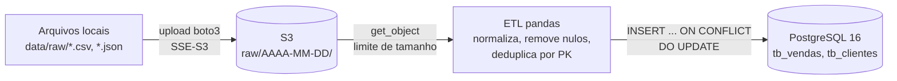

# Cloud Data Pipeline

[](https://github.com/MatheusCavalcanteF/cloud-data-pipeline/actions/workflows/ci.yml)


Pipeline de dados em Python que leva arquivos brutos (CSV e JSON) para um data lake no **AWS S3**, particionado por data, trata os dados com **pandas** e faz a carga **idempotente** no **PostgreSQL**. Reprocessar o mesmo arquivo não duplica registros: chaves já existentes são atualizadas e as novas são inseridas.

## Arquitetura



| Etapa | Módulo | O que faz |
|---|---|---|
| Extração | `src/extraction/s3_uploader.py` | Envia os CSV/JSON de `data/raw/` para `s3://<bucket>/raw/AAAA-MM-DD/` (data UTC), com criptografia SSE-S3 |
| ETL | `src/pipeline/etl_process.py` | Baixa cada objeto (respeitando `MAX_RAW_FILE_MB`), limpa e alinha ao schema da tabela |
| Carga | `src/database/db_connector.py` | Cria a tabela se preciso e faz upsert pela chave primária em uma única transação |
| Schema | `src/database/schemas.py` | Fonte única de tipos, chave primária e colunas obrigatórias |

## Stack

- Python 3.12+ · pandas · boto3
- SQLAlchemy 2 (Core) + psycopg2
- PostgreSQL 16 em Docker (docker compose)
- AWS S3 como camada raw do data lake
- pytest · pip-audit · GitHub Actions · Dependabot

## Como rodar

Pré-requisitos: Python 3.12+, Docker e um bucket S3 que você possa ler e gravar (veja a política mínima em [docs/SECURITY.md](docs/SECURITY.md)).

```bash
# 1. Ambiente virtual e dependências
python -m venv venv
source venv/bin/activate          # Windows: .\venv\Scripts\activate
pip install -r requirements-dev.txt

# 2. Configuração
cp .env.example .env              # Windows: copy .env.example .env
# edite S3_BUCKET_NAME, AWS_REGION e DB_PASSWORD

# 3. Banco de dados (publicado só em 127.0.0.1)
docker compose up -d

# 4. Dados fictícios de exemplo em data/raw/
python data/generate_sample_data.py

# 5. Pipeline completo: S3 -> ETL -> PostgreSQL
python main.py
```

O `main.py` sai com código `0` em caso de sucesso e `1` se alguma etapa falhar, o que facilita agendar a execução (cron, Task Scheduler, orquestrador).

Com os dados de exemplo, as 11 linhas brutas de vendas viram 5 registros em `tb_vendas` e as 9 de clientes viram 4 em `tb_clientes`. O gerador inclui de propósito nulos, duplicatas, espaços sobrando e IDs repetidos com valor corrigido.

### Credenciais AWS

As chaves no `.env` são opcionais. Com `AWS_ACCESS_KEY_ID` e `AWS_SECRET_ACCESS_KEY` vazias, o boto3 usa a cadeia padrão de credenciais: `AWS_PROFILE` e `~/.aws` (inclusive SSO após `aws sso login`) ou a role da instância/container. Esse é o caminho recomendado. Chaves estáticas funcionam, mas precisam vir as duas juntas.

### Variáveis de ambiente

| Variável | Obrigatória | Descrição |
|---|---|---|
| `S3_BUCKET_NAME` | sim | Bucket do data lake |
| `AWS_REGION` | não | Região do bucket (padrão `us-east-1`) |
| `AWS_ACCESS_KEY_ID` / `AWS_SECRET_ACCESS_KEY` | não | Chaves estáticas; vazias = cadeia padrão do boto3 |
| `AWS_PROFILE` | não | Perfil do `~/.aws/config` (lido pelo próprio boto3) |
| `MAX_RAW_FILE_MB` | não | Tamanho máximo, em MiB, de cada arquivo lido do S3 (padrão `100`) |
| `DB_HOST`, `DB_PORT`, `DB_NAME`, `DB_USER`, `DB_PASSWORD` | sim | Conexão com o PostgreSQL |
| `DB_SSLMODE` | não | `sslmode` da libpq (padrão `prefer`; use `verify-full` em banco remoto) |

## Testes

```bash
pytest
```

Os testes rodam sem AWS e sem Docker: o S3 é simulado em memória e a carga usa SQLite em memória com o mesmo upsert (`ON CONFLICT`) do PostgreSQL. Cobrem limpeza, particionamento, upsert idempotente, tipos do schema, credenciais, limite de tamanho, TLS e ausência de dados pessoais nos logs.

O CI roda os testes em Python 3.12 e 3.13 e audita as dependências com `pip-audit` a cada push e pull request para o `main`.

## Decisões de engenharia

- **Chave primária natural.** Os IDs vêm da fonte (`id_venda`, `id_cliente`), então as PKs são declaradas com `autoincrement=False`. Isso evita que o PostgreSQL crie `SERIAL`/sequence que colidiria com os IDs reais.
- **Upsert idempotente.** A carga usa `INSERT ... ON CONFLICT (pk) DO UPDATE` em lotes de 1.000, tudo em uma transação. Rodar o pipeline duas vezes com o mesmo arquivo deixa o banco no mesmo estado; uma falha no meio não deixa carga parcial.
- **Particionamento por data UTC.** Os arquivos vão para `raw/AAAA-MM-DD/` com a data em UTC, para que a partição não dependa do fuso da máquina que roda o job. Reexecutar no mesmo dia sobrescreve o objeto da partição; com versionamento ligado no bucket, as versões anteriores continuam recuperáveis.
- **Limpeza explícita e previsível.** Strings perdem espaços nas bordas e strings vazias viram nulo; linhas totalmente nulas saem; linhas com nulo na PK ou em colunas `nullable=False` saem; duplicatas pela PK mantêm a **última** ocorrência (a correção mais recente vence). Data inválida falha a carga em vez de virar nulo em silêncio.
- **Schema como fonte única de verdade.** Tipos, PK e colunas obrigatórias ficam em `schemas.py` e alimentam tanto a limpeza quanto a criação das tabelas e o upsert. Colunas fora do schema são ignoradas com aviso no log.

## Decisões de segurança

| Risco | Decisão |
|---|---|
| Credenciais no código ou no Git | `.env` fora do versionamento; chaves AWS opcionais, com preferência por perfil, SSO ou role |
| Permissões AWS amplas demais | Política IAM de menor privilégio restrita ao prefixo `raw/` ([docs/SECURITY.md](docs/SECURITY.md)) |
| Dados em repouso no S3 | Cada upload pede SSE-S3 (`AES256`); bucket com Block Public Access e versionamento |
| Banco exposto na rede local | `docker compose` publica a porta só em `127.0.0.1` |
| Tráfego sem TLS até banco remoto | `DB_SSLMODE` configurável (`require`, `verify-full`) |
| Dados pessoais vazando em logs | `hide_parameters=True` no SQLAlchemy; erros de banco logados como classe + SQLSTATE; erro de data cita a coluna, não o valor |
| SQL injection | Todas as queries via SQLAlchemy Core com parâmetros; nenhuma SQL montada com string |
| Senha com `@`, `:` ou `/` quebrando a conexão | URL montada com `URL.create`, que escapa os caracteres |
| Arquivo gigante esgotando memória | `ContentLength` checado antes do download e leitura limitada a `MAX_RAW_FILE_MB` |
| Dependências vulneráveis | Versões fixas, `pip-audit` no CI e Dependabot semanal |
| Cadeia de suprimentos no CI | Actions fixadas por SHA, `permissions: contents: read`, checkout sem persistir credenciais |

Para reportar uma vulnerabilidade, veja [docs/SECURITY.md](docs/SECURITY.md).

## Estrutura

```
.
├── main.py                      # orquestra S3 -> ETL -> PostgreSQL
├── src/
│   ├── config.py                # .env, logging, cliente S3, limites
│   ├── extraction/s3_uploader.py
│   ├── pipeline/etl_process.py
│   └── database/
│       ├── db_connector.py      # engine, upsert, TLS
│       └── schemas.py           # tabelas, PKs e colunas obrigatórias
├── data/generate_sample_data.py # dados fictícios com sujeira proposital
├── tests/
├── docs/SECURITY.md
├── docker-compose.yml
├── requirements.txt             # runtime, versões exatas
└── requirements-dev.txt         # runtime + pytest + pip-audit
```

Convenções de código e comandos do dia a dia estão em [CONTRIBUTING.md](CONTRIBUTING.md).
